# MediAgenda – Hito 2: Integración frontend con PHP

## Propuesta del sistema

**Nombre:** MediAgenda, sistema web de citas médicas.

## Integrantes y roles del hito
| Integrante | Usuario GitHub | Rol |
|------------|----------------|-----|
| Benjamin Concepcion | bconcepcion1376 | Desarrollo (Backend PHP) |
| Dana Wing | dalilaling | Líder de proyecto y repositorio |
| Alvaro Guardia | aguard28 | Diseño y experiencia de usuario |
| Edwin Vergara | simbiak | Calidad, seguridad y documentación |

## Descripción
MediAgenda es un sistema web de citas médicas para las clínicas privadas Minimed en Ciudad de Panamá. Permite a los pacientes reservar, reprogramar y cancelar citas en línea 24/7, sin depender del horario de recepción. El sistema bloquea automáticamente feriados nacionales de Panamá (incluidos carnaval y toma de posesión) y reagenda en bloque las citas cuando un médico se ausenta, evitando traslados innecesarios de los pacientes.

## Requisitos y ejecución

- **PHP 8.2.12** (incluido en XAMPP).
- Sin base de datos, sin frameworks y sin Composer: los datos de ejemplo están en arreglos de PHP.

### Opción 1 · Servidor embebido de PHP

1. Clonar el repositorio y entrar a la rama de entrega:

   ```
   git clone https://github.com/bconcepcion1376/proyecto-semestral-eq05.git
   cd proyecto-semestral-eq05
   git switch entrega-hito2
   ```

2. Iniciar el servidor desde la carpeta del proyecto:

   ```
   C:\xampp\php\php.exe -S localhost:8000
   ```

   Si PHP está en el PATH, basta con `php -S localhost:8000`.

3. Abrir `http://localhost:8000/index.php` en el navegador.

### Opción 2 · Apache de XAMPP

Necesaria para probar `.htaccess`, porque el servidor embebido (`php -S`) no lo lee.

1. Copiar la carpeta del proyecto en `C:\xampp\htdocs\`.
2. Iniciar Apache desde el panel de control de XAMPP.
3. Abrir `http://localhost/proyecto-semestral-eq05/index.php`.

## Prefijo, color de acento y campo especial
- **Prefijo:** `eq05-` (aplicado en todas las clases, IDs y variables CSS)
- **Color de acento:** `#0A62A0` (azul MediAgenda, asignado por el docente)
- **Campo especial:** Número de expediente (exactamente 6 dígitos) en `principal_formulario.php` y `registro.php`

## Reglas de negocio

| Regla | Descripción |
|---|---|
| 24 horas | El paciente reserva, reprograma o cancela con al menos 24 horas de anticipación. Recepción puede hacerlo sin ese límite. |
| R1 | Un médico no puede tener dos citas activas a la misma fecha y hora. |
| R2 | Cada médico tiene un máximo de 8 citas activas por día. El valor es configurable con una constante. |
| R3 | Un paciente no puede tener dos citas activas de la misma especialidad. |

- **Citas activas:** Pendiente, Confirmada, Programada, Reagendada y En sala.
- **Citas no activas:** Cancelada, Atendida y No asistió.

## Datos semilla dictados en clase

| Expediente | Paciente | Especialidad | Médico | Fecha | Hora | Estado |
|---|---|---|---|---|---|---|
| 482915 | Lucía Montenegro-Ríos | Pediatría | Dr. Ignacio Valdelomar | 2026-11-12 | 09:30 | Confirmada |
| 482916 | Teresa D'Alessio | Dermatología | Dra. Pilar Zamudio | 2026-11-13 | 14:00 | Pendiente |
| 482917 | Hernán Quijada | Pediatría | Dr. Ignacio Valdelomar | 2026-11-12 | 10:00 | Cancelada |

## Formularios: GET y POST

**GET** se usa cuando el formulario solo busca o filtra información: no cambia datos y la URL se puede guardar o compartir.
**POST** se usa cuando se envían datos personales o contraseñas, o cuando la acción modifica datos.

| Formulario | Método | Destino |
|---|---|---|
| Buscador de disponibilidad (inicio) | GET | `principal_formulario.php` |
| Filtro combinado del listado de citas | GET | `principal_listado.php` |
| Registro de paciente | POST | `procesar_registro.php` |
| Inicio de sesión | POST | `procesar_login.php` |
| Reservar cita (entidad principal) | POST | `procesar_principal.php` |
| Horario del médico (segunda entidad) | POST | `procesar_secundaria.php` |
| Nota de consulta | POST | `principal_detalle.php` |
| Recuperar contraseña | POST | `recuperar.php` |

## Alcance

### Contexto y problema

Se usaría en las clínicas privadas Minimed, en Ciudad de Panamá. Hoy las citas se agendan en papel o presencialmente, solo en horario de atención, y recepción las reacomoda a mano cuando un médico falta o cae un feriado nacional, carnaval o la toma de posesión.

### Usuarios

| Rol | Qué hace |
|---|---|
| **Paciente** | Solicita, reprograma o cancela sus citas en línea. |
| **Recepción** | Confirma la llegada del paciente y reagenda citas cuando falta el médico. |
| **Médico** | Consulta su agenda y registra una nota de cada consulta. |
| **Administrador** | Gestiona usuarios, roles, especialidades, servicios y feriados. |

### Módulos

1. **Usuarios y roles:** crear, modificar y asignar permisos a los usuarios.
2. **Horarios y disponibilidad:** configurar el horario de cada médico, sus ausencias y los feriados.
3. **Gestión de agenda:** reservar, reprogramar y cancelar citas según la disponibilidad real.
4. **Consulta médica:** registrar la nota e historial del paciente atendido.
5. **Reportes:** informes de citas por mes, médico y especialidad, cancelaciones y ausentismo.

### Entidades de datos

Usuario, Rol, Paciente, Médico, Especialidad, Servicio, Horario, Feriado, Cita y Nota de consulta.

### Fuera de alcance

- Pagos en línea.
- Mensajes por WhatsApp o SMS.
- Facturación a aseguradoras.

### Diferencia

A diferencia de agendar por teléfono o en la libreta de recepción, MediAgenda funciona 24/7, bloquea automáticamente los feriados de Panamá (incluidos carnaval y la toma de posesión) y reagenda en bloque las citas cuando un médico se ausenta.

---

## Hito 1 · Maqueta HTML5 + CSS3 (referencia)

Sitio estático navegable que reproduce los wireframes (`docs/wireframes.pdf`) y aplica la guía de estilo (`docs/guia_estilo.pdf`).

> En el Hito 2 las páginas se migraron a `.php` y sus nombres usan guion bajo (por ejemplo, `principal-formulario.html` pasó a ser `principal_formulario.php`). La tabla siguiente conserva los nombres del Hito 1.

### Páginas

| Archivo | Pantalla del wireframe | Rol de ejemplo |
|---|---|---|
| `index.html` | 1 · Inicio | Público |
| `login.html` | 2 · Inicio de sesión | Público |
| `registro.html` | 3 · Registro de paciente | Público |
| `recuperar.html` | 4 · Recuperación de contraseña | Público |
| `principal-formulario.html` | 5 · Reservar cita (formulario de la entidad principal: **Cita**) | Paciente |
| `principal-listado.html` | 6 · Listado de citas con búsqueda y filtros | Recepción |
| `principal-detalle.html` | 7 · Detalle de cita y nota de consulta | Médico |
| `secundaria-formulario.html` | 8 · Horario y ausencias del médico (segunda entidad: **Horario**) | Administrador |
| `panel.html` | 9 · Panel de administración | Administrador |
| `perfil.html` | 10 · Perfil de usuario | Paciente |
| `error.html` | 10b · Página de error 403 / 404 | Paciente |
| `legal.html` | Privacidad y términos (enlaces del pie) | Público |

El encabezado, el menú y el pie son iguales en todas las páginas. En la maqueta el menú muestra todas las opciones para poder recorrer el sitio; en el sistema real cada rol verá solo las suyas (ver wireframes, pág. 3).

### Estructura

```
index.html, login.html, …           12 páginas HTML enlazadas entre sí
css/estilos.css                     hoja de estilos externa (única)
img/                                logo, ilustraciones, avatar y gráfico (SVG)
img/iconos/                         íconos SVG
docs/                               propuesta, wireframes, guía de estilo y demás entregables
```

### Cumplimiento de requisitos técnicos

| Requisito | Dónde se cumple |
|---|---|
| Estructura base | `<!DOCTYPE html>`, `lang="es"`, `charset`, `viewport`, `<title>` único y `meta description` en cada página. |
| Secciones | `header`, `nav`, `main`, `section`, `article`, `aside`, `footer`; un solo `h1` por página y títulos en orden. |
| Contenido y texto | Listas (`ul`, `ol`, `dl`), `figure`/`figcaption` (inicio y panel), `strong`, `em`, `time`, `abbr`. |
| Tablas | Listado de citas, horario semanal, vista previa del reagendado, citas por especialidad, usuarios y feriados; todas con `caption`, `thead`, `tbody` y `th scope`. |
| Contenido incrustado | Imágenes con `alt`, `width` y `height`; mapa con `iframe` en el inicio. |
| Formularios | 12 formularios, entre ellos inicio de sesión, registro, recuperación, Cita (entidad principal) y Horario (segunda entidad). Cada campo tiene `label for`/`id`; se usan `fieldset`/`legend` y 10 tipos de entrada: `text`, `email`, `password`, `tel`, `date`, `time`, `number`, `search`, `checkbox` y `radio`, con `required`, `placeholder`, `minlength`, `maxlength`, `pattern`, `min`, `max`, `autocomplete` y `name`. |
| CSS3 | Hoja externa `css/estilos.css` enlazada en todas las páginas. Selectores de id (`#eq05-encabezado`), clase (`.eq05-boton`), universal (`*`) y agrupación (`h1, h2, h3, h4`). Prefijo de equipo `eq05-` en todos los id, clases y variables. Diseño con Flexbox y Grid, adaptable a móvil (menú plegable y tabla de citas en tarjetas). |
| Guía de estilo | Color asignado `#0A62A0` y su paleta, tipografía Inter, espaciado base 8 px, botones, campos, estados de cita y avisos tal como se definen en la guía. |

### Validación

Todas las páginas se validaron sin errores con el validador HTML del W3C (Nu Html Checker) y la hoja de estilos con el validador CSS del W3C (perfil CSS3).

| Validador | Resultado |
|---|---|
| HTML · [validator.w3.org/nu](https://validator.w3.org/nu/) | 12 páginas, 0 errores |
| CSS · [jigsaw.w3.org/css-validator](https://jigsaw.w3.org/css-validator/) | `css/estilos.css`, 0 errores |

### Capturas de validación

Validación HTML (Hito 2, HTML generado por PHP):

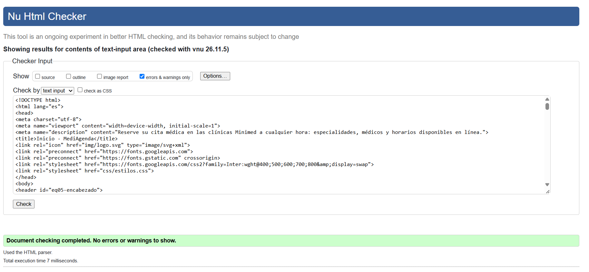
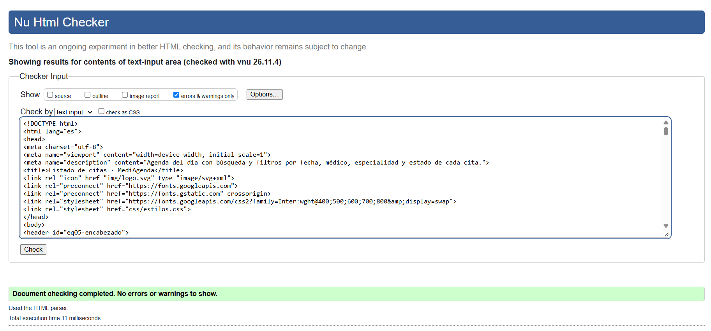
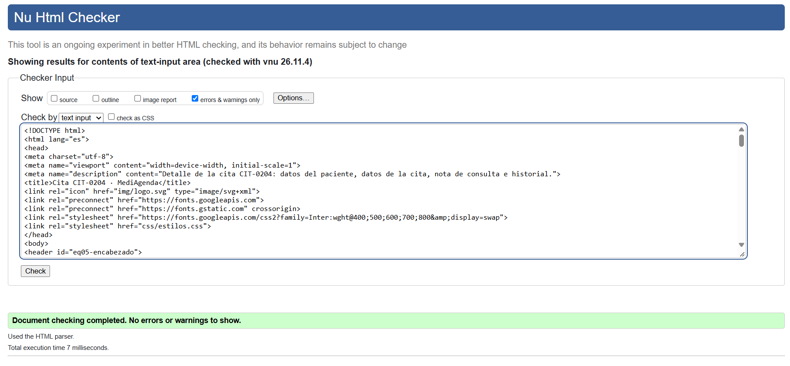
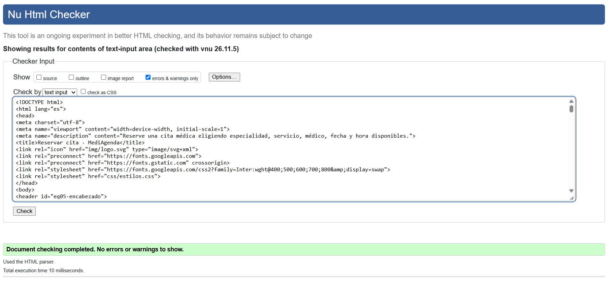
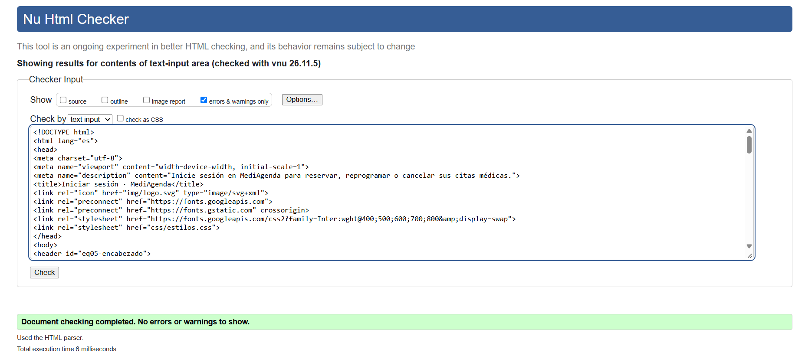
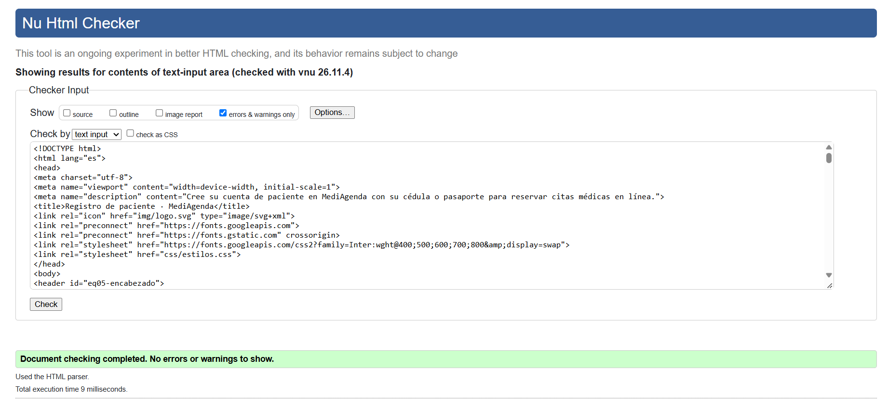
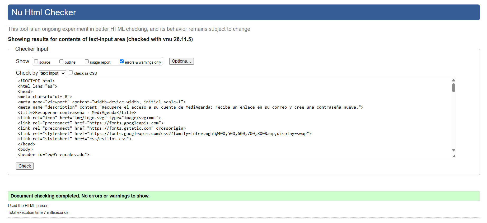
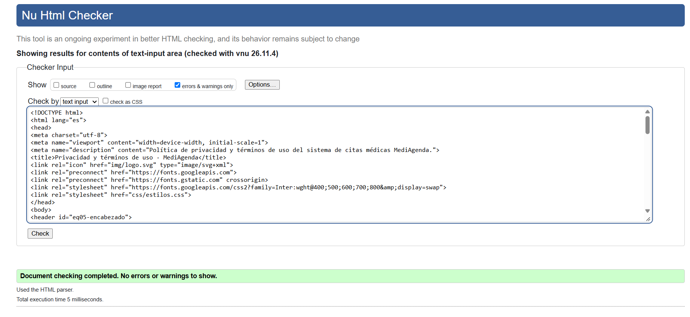
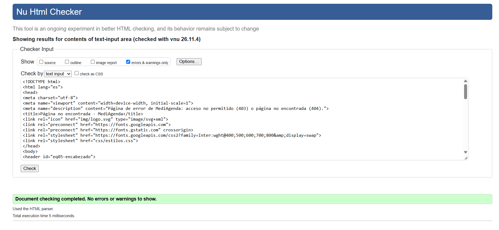
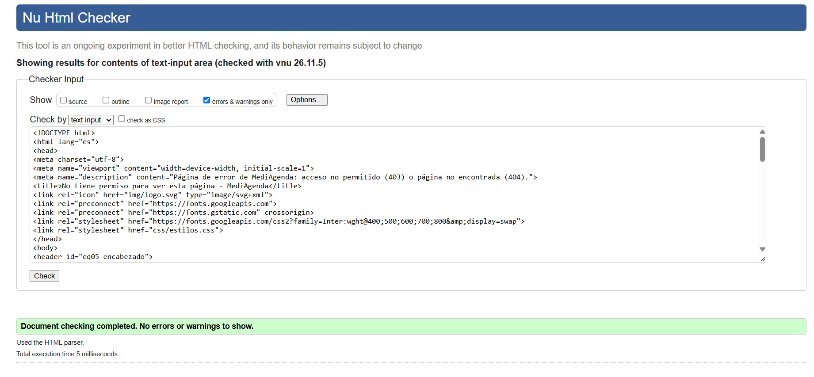
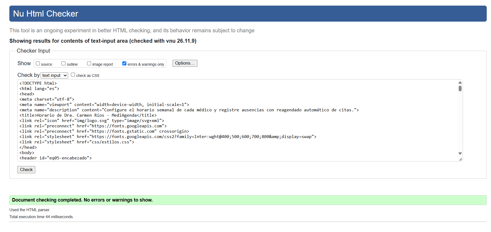

Validación CSS:
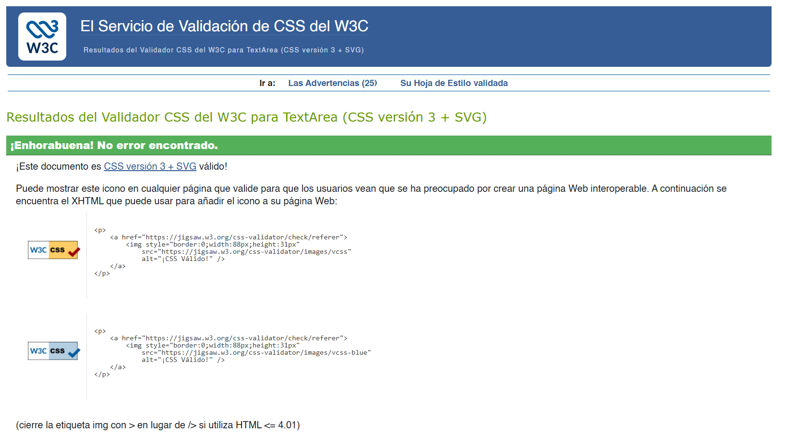

## Declaración de herramientas
De conformidad con la política de integridad académica del curso:

### Hito 1

Se utilizó inteligencia artificial (Qwen) exclusivamente como **asistente de auditoría y revisión** para:
1. Verificar el cumplimiento de la rúbrica del Hito 1.
2. Sugerir mejoras de accesibilidad.

### Hito 2

| Integrante | Herramienta | Para qué | En qué parte |
|---|---|---|---|
| Benjamin Concepcion | Claude (Anthropic) | Guía paso a paso, explicación de conceptos (GET y POST, includes, `htmlspecialchars`, `http_response_code`, zona horaria), interpretación de errores y revisión de cada cambio antes del commit. | Migración de `index`, `login`, `registro`, `recuperar`, `principal_formulario`, `principal_listado`, `principal_detalle`, `error` y `legal`; revisión del Pull Request de Alvaro. |
| Benjamin Concepcion | Claude (Anthropic) | Generó el código de las filas 4 a 6 del calendario, que Benjamin revisó y adaptó. | `principal_formulario.php` (calendario de noviembre 2026). |
| Benjamin Concepcion | Claude (Anthropic) | Generó un borrador de `includes/encabezado.php` que se entregó a Alvaro como referencia. | `includes/encabezado.php` |
| Alvaro Guardia | (completar) | (completar) | (completar) |
| Dana Wing | (completar) | (completar) | (completar) |
| Edwin Vergara | (completar) | (completar) | (completar) |

Todo el código entregado fue revisado por el equipo y puede ser explicado por cualquiera de sus integrantes.

---

© 2026 MediAgenda · Proyecto semestral, Equipo 05 · Clínicas Minimed, Ciudad de Panamá