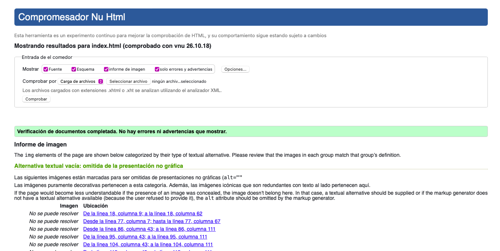
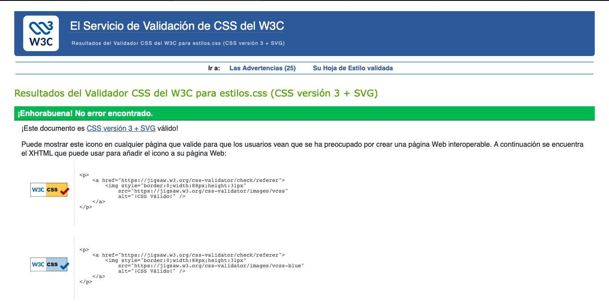

# MediAgenda – Kickoff (Hito 1, Fase Inicial)

## Propuesta del sistema

**Nombre:** MediAgenda, sistema web de citas médicas.

## Alcance

### Contexto y problema

Se usaría en las clínicas privadas Minimed, en Ciudad de Panamá. Hoy las citas se agendan en papel o presencialmente, solo en horario de atención, y recepción las reacomoda a mano cuando un médico falta o cae un feriado nacional, carnaval o la toma de posesión.

### Usuarios

| Rol | Qué hace |
|---|---|
| **Paciente** | Solicita, reprograma o cancela sus citas en línea. |
| **Recepción** | Confirma la llegada del paciente y reagenda citas cuando falta el médico. |
| **Médico** | Consulta su agenda y registra una nota de cada consulta. |
| **Administrador** | Gestiona usuarios, roles, especialidades, servicios y feriados. |

### Módulos

1. **Usuarios y roles:** crear, modificar y asignar permisos a los usuarios.
2. **Horarios y disponibilidad:** configurar el horario de cada médico, sus ausencias y los feriados.
3. **Gestión de agenda:** reservar, reprogramar y cancelar citas según la disponibilidad real.
4. **Consulta médica:** registrar la nota e historial del paciente atendido.
5. **Reportes:** informes de citas por mes, médico y especialidad, cancelaciones y ausentismo.

### Entidades de datos

Usuario, Rol, Paciente, Médico, Especialidad, Servicio, Horario, Feriado, Cita y Nota de consulta.

### Fuera de alcance

- Pagos en línea.
- Mensajes por WhatsApp o SMS.
- Facturación a aseguradoras.

### Diferencia

A diferencia de agendar por teléfono o en la libreta de recepción, MediAgenda funciona 24/7, bloquea automáticamente los feriados de Panamá (incluidos carnaval y la toma de posesión) y reagenda en bloque las citas cuando un médico se ausenta.

---

## D. Maqueta HTML5 + CSS3

Sitio estático navegable que reproduce los wireframes (`docs/wireframes.pdf`) y aplica la guía de estilo (`docs/guia_estilo.pdf`). Para verlo, abra `index.html` en el navegador o use la extensión *Live Server* de VS Code.

### Páginas

| Archivo | Pantalla del wireframe | Rol de ejemplo |
|---|---|---|
| `index.html` | 1 · Inicio | Público |
| `login.html` | 2 · Inicio de sesión | Público |
| `registro.html` | 3 · Registro de paciente | Público |
| `recuperar.html` | 4 · Recuperación de contraseña | Público |
| `principal-formulario.html` | 5 · Reservar cita (formulario de la entidad principal: **Cita**) | Paciente |
| `principal-listado.html` | 6 · Listado de citas con búsqueda y filtros | Recepción |
| `principal-detalle.html` | 7 · Detalle de cita y nota de consulta | Médico |
| `secundaria-formulario.html` | 8 · Horario y ausencias del médico (segunda entidad: **Horario**) | Administrador |
| `panel.html` | 9 · Panel de administración | Administrador |
| `perfil.html` | 10 · Perfil de usuario | Paciente |
| `error.html` | 10b · Página de error 403 / 404 | Paciente |
| `legal.html` | Privacidad y términos (enlaces del pie) | Público |

El encabezado, el menú y el pie son iguales en todas las páginas. En la maqueta el menú muestra todas las opciones para poder recorrer el sitio; en el sistema real cada rol verá solo las suyas (ver wireframes, pág. 3).

### Estructura

```
index.html, login.html, …           12 páginas HTML enlazadas entre sí
css/estilos.css                     hoja de estilos externa (única)
img/                                logo, ilustraciones, avatar y gráfico (SVG)
img/iconos/                         íconos SVG
docs/                               propuesta, wireframes, guía de estilo y demás entregables
```

### Cumplimiento de requisitos técnicos

| Requisito | Dónde se cumple |
|---|---|
| Estructura base | `<!DOCTYPE html>`, `lang="es"`, `charset`, `viewport`, `<title>` único y `meta description` en cada página. |
| Secciones | `header`, `nav`, `main`, `section`, `article`, `aside`, `footer`; un solo `h1` por página y títulos en orden. |
| Contenido y texto | Listas (`ul`, `ol`, `dl`), `figure`/`figcaption` (inicio y panel), `strong`, `em`, `time`, `abbr`. |
| Tablas | Listado de citas, horario semanal, vista previa del reagendado, citas por especialidad, usuarios y feriados; todas con `caption`, `thead`, `tbody` y `th scope`. |
| Contenido incrustado | Imágenes con `alt`, `width` y `height`; mapa con `iframe` en el inicio. |
| Formularios | 12 formularios, entre ellos inicio de sesión, registro, recuperación, Cita (entidad principal) y Horario (segunda entidad). Cada campo tiene `label for`/`id`; se usan `fieldset`/`legend` y 10 tipos de entrada: `text`, `email`, `password`, `tel`, `date`, `time`, `number`, `search`, `checkbox` y `radio`, con `required`, `placeholder`, `minlength`, `maxlength`, `pattern`, `min`, `max`, `autocomplete` y `name`. |
| CSS3 | Hoja externa `css/estilos.css` enlazada en todas las páginas. Selectores de id (`#eq05-encabezado`), clase (`.eq05-boton`), universal (`*`) y agrupación (`h1, h2, h3, h4`). Prefijo de equipo `eq05-` en todos los id, clases y variables. Diseño con Flexbox y Grid, adaptable a móvil (menú plegable y tabla de citas en tarjetas). |
| Guía de estilo | Color asignado `#0A62A0` y su paleta, tipografía Inter, espaciado base 8 px, botones, campos, estados de cita y avisos tal como se definen en la guía. |

> Los formularios usan `method="get"` y apuntan a la página siguiente solo para que la maqueta sea navegable sin servidor. En la versión con backend se enviarán por POST.

### Validación

Todas las páginas se validaron sin errores con el validador HTML del W3C (Nu Html Checker) y la hoja de estilos con el validador CSS del W3C (perfil CSS3).

| Validador | Resultado |
|---|---|
| HTML · [validator.w3.org/nu](https://validator.w3.org/nu/) | 12 páginas, 0 errores |
| CSS · [jigsaw.w3.org/css-validator](https://jigsaw.w3.org/css-validator/) | `css/estilos.css`, 0 errores |

Capturas:

<!-- Agregar las capturas del validador en docs/validacion/ y enlazarlas aquí, por ejemplo: -->
<!--  -->
<!--  -->
